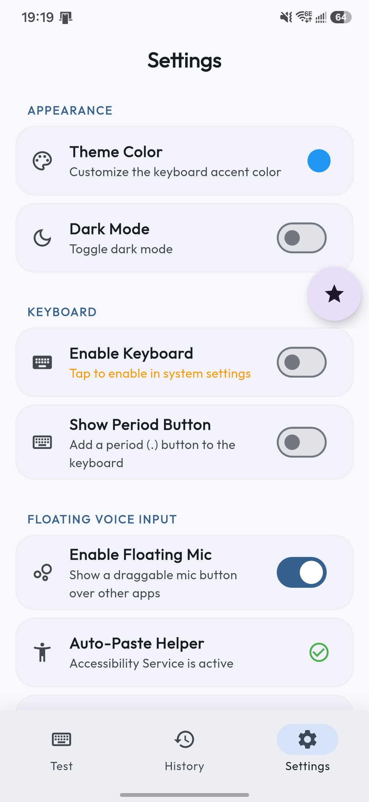
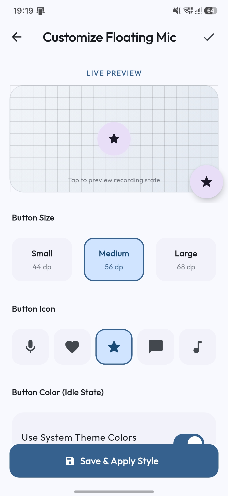
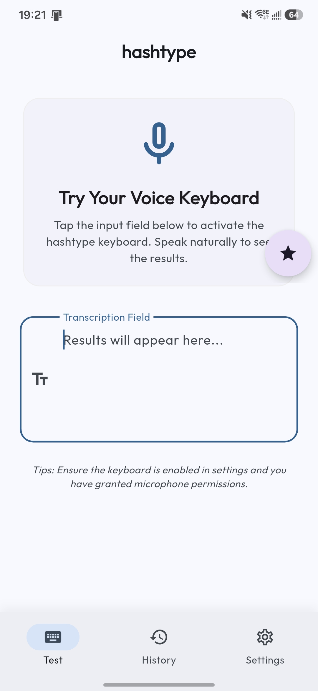
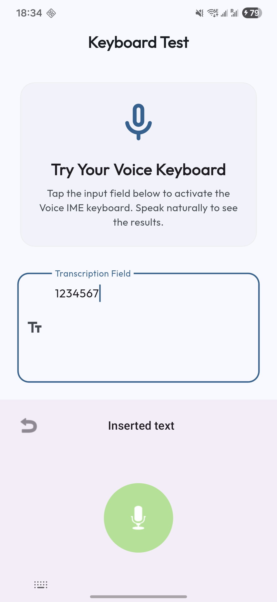
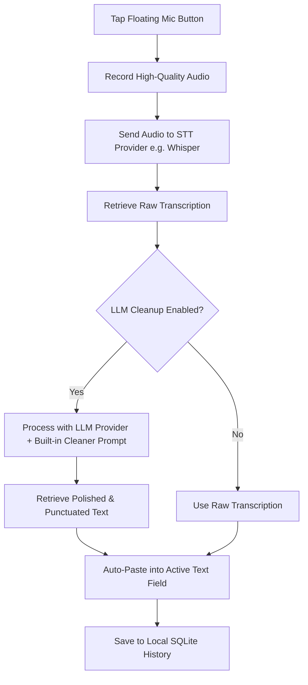

<p align="center">
  
</p>

# Hashtype 🎙️🤖

[English](README.md) | [简体中文](README_zh.md)

**Hashtype** is a modern, open-source Android Voice-Typing Assistant and Floating Microphone built **100% in Native Kotlin with Jetpack Compose (Material 3)**. It is designed specifically for users who want complete control over their speech-to-text (STT) pipeline and data privacy.

Unlike traditional voice-typing tools that lock you into a single corporate service, Hashtype lets you bring your own API keys for **Speech-to-Text (STT)** and overlay **Large Language Models (LLMs)** to clean disfluencies, remove filler words, format punctuation, and polish voice transcriptions in real time before pasting directly into your active input field.

---

## 📸 App Screenshots

### Setup & AI Configuration

| ⚙️ Settings Dashboard | 🎙️ Speech-To-Text Config | 🤖 Language Model Config |
| :---: | :---: | :---: |
|  |  |  |

### Floating Voice Input & Results

| 🫧 Floating Mic Customizer | 💬 Floating Mic In-App Overlay | 📝 Text Insertion Result |
| :---: | :---: | :---: |
|  |  |  |

---

## 🚀 Key Features

*   **🫧 Keyboard-Driven Floating Mic:** Appears automatically when your keyboard pops up and hides smoothly when dismissed. Drag anywhere on screen and tap to dictate without switching keyboards.
*   **🎙️ Bring Your Own API (STT):** Connect directly to OpenAI Whisper, Groq, Mistral, or your own self-hosted Whisper-compatible endpoint.
*   **🤖 Real-Time Dynamic Model Fetching:** Automatically queries and lists available models from OpenAI, Anthropic, Google Gemini, Groq, and Mistral in real time.
*   **✨ Built-in Strict Transcription Cleaner:** Built-in post-processing prompt removes verbal filler words ("um", "uh", "like", "那个", "就是") and injects punctuation while strictly transcribing your words without answering questions or following spoken commands.
*   **📋 Smart Auto-Paste Helper:** Seamlessly inserts transcribed text directly into any active input field using Android Accessibility.
*   **📜 Local SQLite History:** View, search, and copy a secure local log of all voice transcriptions with one-tap search and cleanup.
*   **🎨 Dynamic Material You Design:** Adapts automatically to your wallpaper palette with Material 3 dynamic colors, edge-to-edge support, and smooth bottom sheets.
*   **🔒 Privacy-First Architecture:** 
    *   Direct device-to-provider communication with no intermediate tracking servers.
    *   Zero analytics or third-party ads.

---

## 🏗️ How It Works (Transcription Pipeline)



---

## ⚙️ Supported Providers

| Provider | Speech-to-Text (STT) | Language Models (LLM) | Connection Method |
| :---: | :---: | :---: | :---: |
| **OpenAI** | ✅ (Whisper-1) | ✅ (GPT-4o, GPT-4o-mini, o1, etc.) | Official API |
| **Google Gemini** | ❌ | ✅ (Gemini 1.5 Pro/Flash, Gemini 2.0) | Official API |
| **Anthropic** | ❌ | ✅ (Claude 3.5 Sonnet, Claude 3.5 Haiku) | Official API |
| **Groq** | ✅ (Whisper Large V3, Turbo) | ✅ (Llama 3.3, Mixtral, etc.) | Official API |
| **Mistral** | ✅ (Audio transcription) | ✅ (Mistral Large, Mistral Small) | Official API |
| **Custom Endpoint**| ✅ (OpenAI API Compatible) | ✅ (OpenAI API Compatible) | Self-hosted or gateway |

---

## 🛠️ Installation & Setup

### Step 1: Install the APK
*   Download the latest release APK from the [Releases](https://github.com/blakejjia/hush-type/releases) page and install it on your Android device.

### Step 2: Configure API Keys & Models
1.  Open **Hashtype** from your app drawer.
2.  Tap **Speech-to-Text**, select your provider, enter your API Key, and pick your transcription model.
3.  Tap **Language Models**, enable LLM cleanup, pick your preferred LLM provider, enter your API key, and choose your model.

### Step 3: Enable Accessibility Helper (Auto-Paste)
1.  In **Hashtype**, tap **Auto-Paste Helper**.
2.  Enable the **Hashtype Floating Mic & Auto-Paste Helper** service in Android Accessibility Settings.
3.  Whenever you tap into a text field and your keyboard opens, the floating mic button will appear ready to transcribe!

---

## 🧱 Architecture: 100% Native Kotlin

```
hashtype/
├── app/
│   ├── src/main/
│   │   ├── AndroidManifest.xml
│   │   ├── kotlin/com/jia_yx/hashtype/
│   │   │   ├── HashtypeApp.kt               # Application entrypoint
│   │   │   ├── MainActivity.kt              # Compose ComponentActivity
│   │   │   ├── HashtypeFloatingService.kt   # Keyboard-driven floating mic & auto-paste
│   │   │   ├── VoiceImeViewModel.kt         # Audio recorder & API pipelines
│   │   │   ├── HistoryDbHelper.kt           # Local SQLite transcription history
│   │   │   ├── data/
│   │   │   │   ├── AppSettings.kt           # Settings repository
│   │   │   │   └── AiProviders.kt           # Provider specs & dynamic model fetching
│   │   │   └── ui/
│   │   │       ├── MainScreen.kt            # Bottom navigation
│   │   │       ├── theme/                   # Material 3 DynamicColors
│   │   │       └── screens/                 # Modal bottom sheets & screens
│   │   └── res/                             # Vector icons, drawables & layouts
│   └── build.gradle.kts                     # Gradle configuration
```

---

## 🧑‍💻 Build Instructions

```bash
# Clone the repository
git clone https://github.com/blakejjia/hush-type.git
cd hush-type

# Build debug APK
./gradlew assembleDebug --no-daemon

# Install onto connected device
adb install -r app/build/outputs/apk/debug/app-debug.apk
```

---

## 📄 License

This project is licensed under the **GNU General Public License v3.0 (GPL v3)** - see the [LICENSE](LICENSE) file for details.
