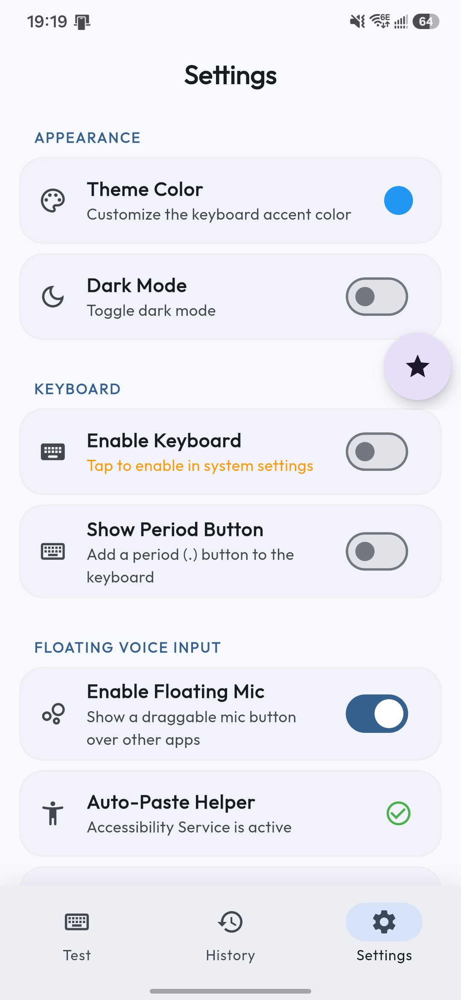
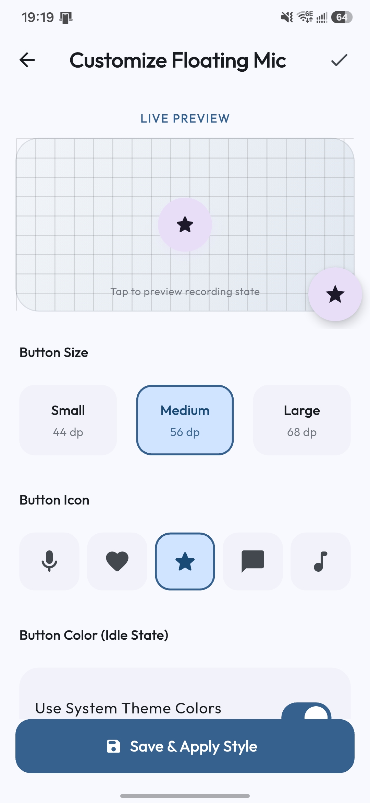
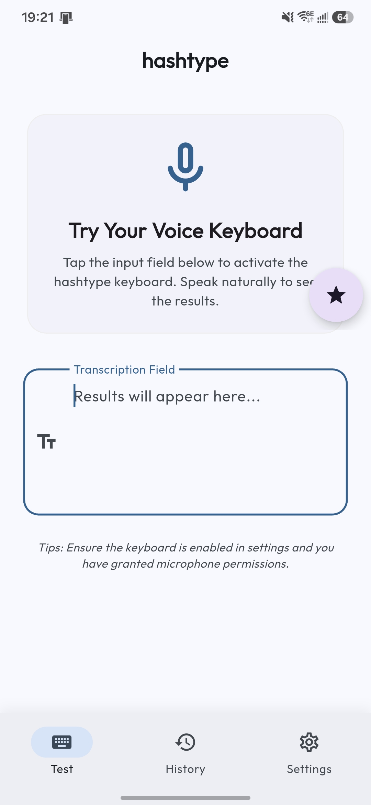
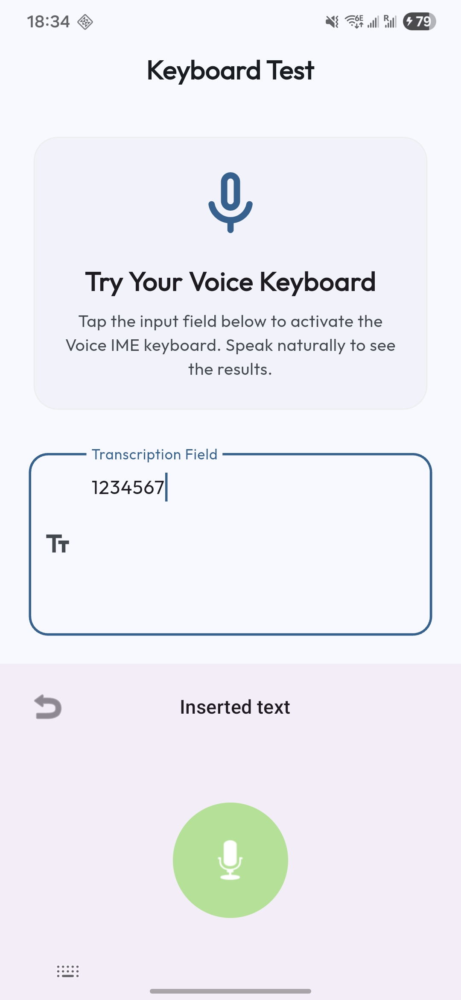

<p align="center">
  
</p>

# Hashtype 🎙️🤖

[English](README.md) | [简体中文](README_zh.md)

**Hashtype** 是一款现代、纯原生、开源的 Android 语音输入助手与光标悬浮麦克风，采用 **100% 纯原生 Kotlin + Jetpack Compose (Material 3)** 构建。专为希望完全掌控语音转文字（STT）流程和数据隐私的用户设计。

与将你锁定在单一服务商的传统语音输入工具不同，Hashtype 允许你使用自己的 **语音转文字 (STT)** API 密钥，并叠加利用 **大语言模型 (LLM)** 在文字输入前实时消除口语赘词、规范标点符号并进行文本清洗。

---

## 📸 应用截图

### 系统设置与 AI 配置

| ⚙️ 设置面板 | 🎙️ STT 语音转文字配置 | 🤖 LLM 语言模型配置 |
| :---: | :---: | :---: |
|  |  |  |

### 悬浮麦克风与输入效果

| 🫧 悬浮麦克风个性化 | 💬 悬浮麦克风桌面组件 | 📝 文本自动粘贴输入 |
| :---: | :---: | :---: |
|  |  |  |

---

## 🌟 核心特性

- **🫧 键盘驱动的智能悬浮麦克风：** 用户软键盘弹起时自动展示，键盘收起时自动平滑隐藏；可全屏自由拖拽吸附，无需切换当前正在使用的输入法即可随时语音输入。
- **🎙️ 自定义 API 接口 (STT)：** 支持连接 OpenAI Whisper、Groq、Mistral 或任何自建的兼容 OpenAI Whisper 标准的语音转写服务。
- **🤖 实时动态获取服务商模型：** 选择服务商或输入 API Key 后，自动通过网络实时拉取该服务商（OpenAI, Anthropic, Google Gemini, Groq, Mistral）最新的模型列表供你选择。
- **✨ 内置严格语音转写清洗提示词：** 内置深度调优的清洗规则，自动去除口语冗余词（如“呃”、“啊”、“那个”、“就是”）并规整标点符号；**严格只做转写与清洗，绝不回答用户问题或执行口述指令**。
- **📋 智能自动粘贴辅助：** 转写与润色完成后，通过无障碍辅助服务自动将文本精准粘贴插入到当前激活的光标位置。
- **📜 本地 SQLite 历史记录：** 本地持久化保存语音转录记录，支持一键实时搜索与清理。
- **🎨 原生 Material You 动态色彩：** 完美适配 Material 3 动态色彩规范与 edge-to-edge 设计，支持 Modal Bottom Sheet 抽屉交互。
- **🔒 隐私至上：** 无任何中间服务器收集数据，设备直连你配置的 API 接口；无任何第三方统计分析和广告。

---

## 🚀 安装与设置

### 第 1 步：安装 APK
- 从 [GitHub Releases](https://github.com/blakejjia/hush-type/releases) 页面下载最新版 APK 并安装到你的 Android 设备。

### 第 2 步：配置服务商与模型
1. 从桌面打开 **Hashtype** 应用。
2. 进入 **Speech-to-Text**，选择服务商，输入你的 API Key，并选择转录模型。
3. 进入 **Language Models**，开启 LLM 清洗，选择语言模型服务商，输入 API Key 并选择模型。

### 第 3 步：开启无障碍自动粘贴辅助
1. 在 Hashtype 设置中点击 **Auto-Paste Helper**。
2. 在系统无障碍设置中启用 **Hashtype Floating Mic & Auto-Paste Helper** 服务。
3. 之后在任何应用中呼出键盘时，屏幕上就会自动浮现悬浮麦克风，点击即可畅快语音输入！

---

## 🏗️ 架构概览 (100% Native Kotlin)

```
hashtype/
├── app/
│   ├── src/main/
│   │   ├── AndroidManifest.xml
│   │   ├── kotlin/com/jia_yx/hashtype/
│   │   │   ├── HashtypeApp.kt               # 应用入口
│   │   │   ├── MainActivity.kt              # Compose ComponentActivity
│   │   │   ├── HashtypeFloatingService.kt   # 键盘联动悬浮麦克风与自动粘贴
│   │   │   ├── VoiceImeViewModel.kt         # 音频录制与 API 网络处理
│   │   │   ├── HistoryDbHelper.kt           # SQLite 本地转录历史库
│   │   │   ├── data/
│   │   │   │   ├── AppSettings.kt           # 本地配置仓储
│   │   │   │   └── AiProviders.kt           # 服务商定义与实时模型拉取
│   │   │   └── ui/
│   │   │       ├── MainScreen.kt            # 底部导航
│   │   │       ├── theme/                   # Material 3 动态主题
│   │   │       └── screens/                 # Modal bottom sheets 与界面
│   │   └── res/                             # 矢量图标与资源
│   └── build.gradle.kts                     # Gradle 构建脚本
```

---

## 📄 开源协议

本项目采用 [GNU General Public License v3.0 (GPL v3)](LICENSE) 开源协议。
